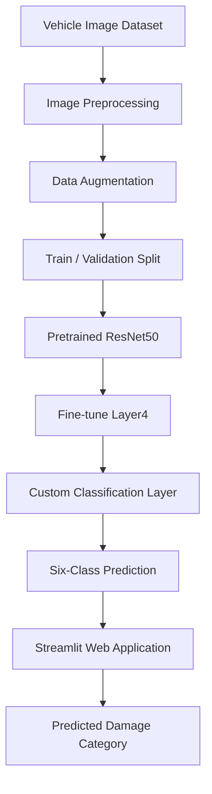

# Car Damage Detection Using Deep Learning

A deep learning-based image classification project that identifies vehicle damage from car images using **ResNet50 Transfer Learning, PyTorch, and Streamlit**.

## Project Overview

Car damage assessment is an important part of vehicle inspection and insurance claim processing. Manual inspection can be time-consuming and subjective.

This project explores automated vehicle damage classification using convolutional neural networks and transfer learning.

The model classifies vehicle images into six categories based on the damage location and condition.

## Project Objectives

- Identify damage in the front and rear sections of vehicles.
- Classify vehicles as normal, broken, or crushed.
- Explore CNN architectures and transfer learning.
- Compare different pretrained models.
- Deploy the trained model through an interactive Streamlit application.

## Classification Categories

The model supports six classes:

| Category | Description |
|---|---|
| Front Breakage | Breakage detected at the front |
| Front Crushed | Front section appears crushed |
| Front Normal | Front section appears normal |
| Rear Breakage | Breakage detected at the rear |
| Rear Crushed | Rear section appears crushed |
| Rear Normal | Rear section appears normal |

## Technologies Used

- Python
- PyTorch
- Torchvision
- ResNet50
- EfficientNet-B0
- Convolutional Neural Networks (CNN)
- Transfer Learning
- Scikit-learn
- NumPy
- Matplotlib
- Streamlit
- Pillow

## Dataset

The project uses a vehicle damage image dataset containing approximately 2,300 images across six categories.

The dataset is organized into class-specific folders and loaded using PyTorch's `ImageFolder`.

**Dataset split:**

- Training: 1,725 images (75%)
- Validation: 575 images (25%)

The dataset is not included in this repository.

## Data Preprocessing

Images undergo the following preprocessing operations:

- Resize images to 224 × 224 pixels.
- Convert images into PyTorch tensors.
- Normalize using ImageNet mean and standard deviation.
- Apply random horizontal flipping.
- Apply random rotation (10 degrees).
- Apply brightness and contrast augmentation.

## Model Development

Multiple architectures were explored during experimentation:

1. Custom CNN
2. CNN with Batch Normalization and Regularization
3. EfficientNet-B0
4. ResNet50

### Final Model: ResNet50

The final implementation uses a pretrained ResNet50 architecture with transfer learning.

**Architecture configuration:**

- Pretrained ImageNet weights.
- Frozen backbone layers.
- Unfrozen `layer4` for fine-tuning.
- Custom fully connected classification layer.
- Dropout rate: 0.2.
- Output classes: 6.

**Training configuration:**

| Parameter | Value |
|---|---|
| Optimizer | Adam |
| Learning Rate | 0.005 |
| Loss Function | CrossEntropyLoss |
| Epochs | 10 |
| Batch Size | 32 |
| Input Size | 224 × 224 |

## Model Performance

The final ResNet50 experiment achieved the following reported validation results:

| Metric | Score |
|---|---:|
| Accuracy | 82% |
| Macro Precision | 0.81 |
| Macro Recall | 0.81 |
| Macro F1-score | 0.81 |
| Weighted F1-score | 0.82 |

### Class-wise F1-score

| Classification | F1-score |
|---|---:|
| Front Breakage | 0.88 |
| Front Crushed | 0.79 |
| Front Normal | 0.92 |
| Rear Breakage | 0.77 |
| Rear Crushed | 0.69 |
| Rear Normal | 0.79 |

*Note: These are the recorded validation results from the notebook, not results from an independent test dataset. The validation subset uses the same randomly augmented dataset transform as the training subset.*

## Project Architecture



## Streamlit Application

The trained model is integrated into a Streamlit application.

The application allows users to provide a vehicle image and receive a predicted damage category.

### Application Features

- Image-based vehicle damage prediction.
- Automatic image preprocessing.
- ResNet50-based classification.
- Six damage categories.
- Interactive Streamlit interface.

## Installation and Setup

### 1. Clone the repository

```bash
git clone https://github.com/rahulyadav1999/car-damage-detection.git

cd car-damage-detection
```

### 2. Create a virtual environment

```bash
python3 -m venv venv

source venv/bin/activate
```

### 3. Install dependencies

```bash
python3 -m pip install -r streamlit_app/requirments.txt
```

### 4. Download or provide the dataset

Place your dataset in the root directory:

```text
dataset/
├── F_Breakage/
├── F_Crushed/
├── F_Normal/
├── R_Breakage/
├── R_Crushed/
└── R_Normal/
```

### 5. Run the Streamlit application

```bash
python3 -m streamlit run streamlit_app/app.py
```

The application will open in your browser.

## Trained Model

The trained model weights are stored in `saved_model.pth` and tracked using Git LFS.

## Future Improvements

- Improve classification accuracy.
- Experiment with additional transfer learning architectures.
- Add prediction confidence scores.
- Evaluate model performance on an independent test dataset.
- Improve the Streamlit user interface.
- Explore object detection and damage localization.

## Author

**Rahul Yadav Nethula**

- GitHub: https://github.com/rahulyadav1999
- LinkedIn: https://linkedin.com/in/rahul-yadav-nethula

---

If you find this project interesting, feel free to explore the repository and share your feedback!
